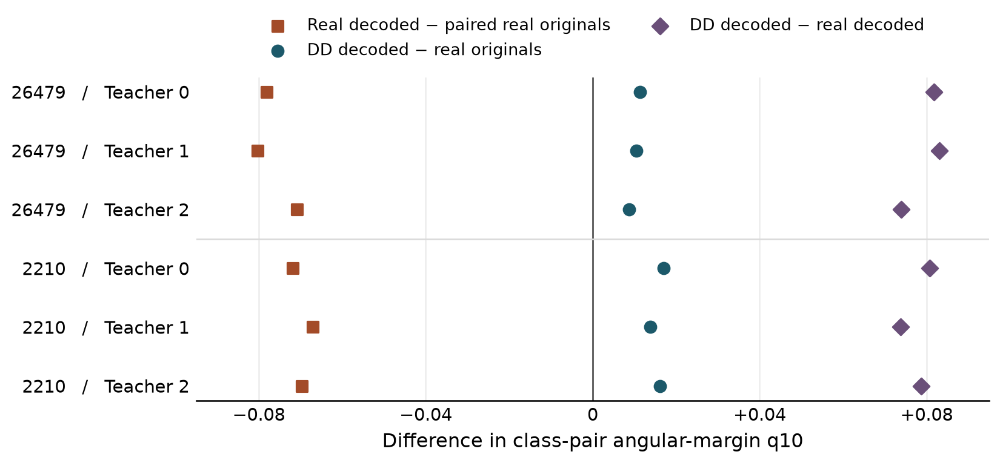

# Preserving Class-Pair Margins in Dataset Distillation

## Introduction

Dataset distillation makes repeated model training cheaper by replacing a real training set with a small synthetic one. A student trained on that synthetic set must still learn where neighboring classes differ. Neural Characteristic Function Matching (NCFM) aligns class-conditional features of real and synthetic data and uses a pretrained classifier for an additional calibration update. On PathMNIST, we observe that decoded synthetic views can have larger low-quantile teacher margins than equally sized sets of real training images. A large margin means that the teacher scores the correct class well above a specific alternative. A deficit of lower-margin views may leave less supervision near boundaries between classes. [Wang et al., CVPR 2025](https://arxiv.org/abs/2502.20653). [Yang et al., Scientific Data 2023](https://www.nature.com/articles/s41597-022-01721-8).

We investigate whether correcting the distribution of those margins helps a student distinguish competing classes. Matching a single confidence score per example retains the distance to the strongest competitor while discarding which competitor produced that score. The proposed objective retains that identity and matches the lower quantiles separately for recurrent competitors. This design keeps synthetic image storage, the view decoder, and the base distillation objective fixed.

## Method

Let $x$ be a real image or a decoded synthetic view of class $c$. For a pretrained teacher $t$, write $z_t(x)$ for its penultimate features and $w_{t,j}$ for its classifier weight for class $j$. Define $a_{t,j}(x)=\langle z_t(x)/\|z_t(x)\|,w_{t,j}/\|w_{t,j}\|\rangle$. The angular margin between $c$ and $j$ is $m_{t,c,j}(x)=a_{t,c}(x)-a_{t,j}(x)$. The normalized score excludes the classifier bias and the feature and weight norms.

For each teacher and class we use real training images to find the two non-target labels that most frequently achieve the highest non-target logit. For each selected class pair we store the 10th, 25th, and 50th percentiles of the real angular margins. Using the logits for selection captures alternatives from the original teacher decision rule. Using angular margins for matching makes the correction independent of the magnitudes of the teacher features and weights.

During condensation the original decoder converts each synthetic canvas into four views. The base CF objective compares augmented real and synthetic features under the intermediate model sampled by NCFM. The auxiliary objective uses the same iteration's final teacher and unaugmented decoded views, with channel normalization shared with the real targets. It penalizes the mean squared difference between the three synthetic quantiles and the stored targets, averaged over the two competing classes. The auxiliary gradients pass through the frozen teacher and the decoder to the synthetic canvases. The existing calibration update is retained. The auxiliary coefficient is fixed at 100 for the planned comparison.

The overall-margin control uses the same teacher, views and quantiles for $a_{t,c}(x)-\max_{j\ne c}a_{t,j}(x)$. The base control omits the auxiliary loss. Together the controls test whether the choice of competing label contributes beyond matching the strongest-competitor margin.

## Evaluation Setup

PathMNIST uses the official MedMNIST splits. Each arm stores 10 RGB canvases per class at $32\times32$ and trains students on 40 decoded views per class. Each condensation arm uses the same pool of 20 ConvNetD3 teachers, 4,096 frequencies and 20,000 condensation iterations. Condensation seeds are paired across arms. Five fresh students per condensed set train for 2,000 epochs under the same evaluation recipe. The official validation split selects the student epoch and the test split supplies accuracy, balanced accuracy and class recall. We average student outcomes within each condensed set before comparing paired condensation seeds.

## Frozen-Teacher Observation

We evaluated two archived synthetic sets using three checkpoints each from a teacher bank excluded from the corresponding condensation run. For each teacher we selected two competitors per class on 512 real training images per class. A disjoint reference set provided 12 groups of 40 images per class, matching the synthetic view count. The mean class-pair difference in the 10th percentile ranged from 0.0088 to 0.0114 for one synthetic set and from 0.0138 to 0.0169 for the other. Differences were positive for 12 to 14 of the 18 class pairs in each evaluation. Repeated measurements across teachers assess sensitivity to the teacher checkpoint. They share two condensed sets and provide the motivation for the downstream comparison. [Diagnostic results](../study_results/RESULTS_20261126_CN.md).

We also applied the same crop-and-upsample decoder to 10 real images in each reference block. The real-image q10 decreased by 0.0671 to 0.0804 across the six teacher and artifact combinations, and the q10 of the synthetic views exceeded the decoded-real reference by 0.0738 to 0.0830. Thus applying the decoder to real images moved the margins in the opposite direction to the observed synthetic-versus-real gap. These measurements describe the crop-and-upsample transformation together with inherited crop labels and finite-sample quantile effects. [Decode control](../study_results/diagnostics/rival_margin_crossbank_decode.json).

**Figure 1.** Each row corresponds to one synthetic set and one checkpoint from its held-out teacher bank. Markers show mean differences in q10, averaged over nine classes and two competitors per class. The paired real-image contrast compares the same 10 source images before and after decoding into 40 views. The 40-image original reference matches the number of decoded views. [Vector figure](rival_margin_diagnostics.pdf).

## Downstream Evaluation

| Method | Test accuracy (%) | Balanced accuracy (%) |
|---|---:|---:|
| NCFM | — | — |
| NCFM + overall-margin matching | — | — |
| NCFM + class-pair margin matching | — | — |

An em dash marks an unavailable measurement.
